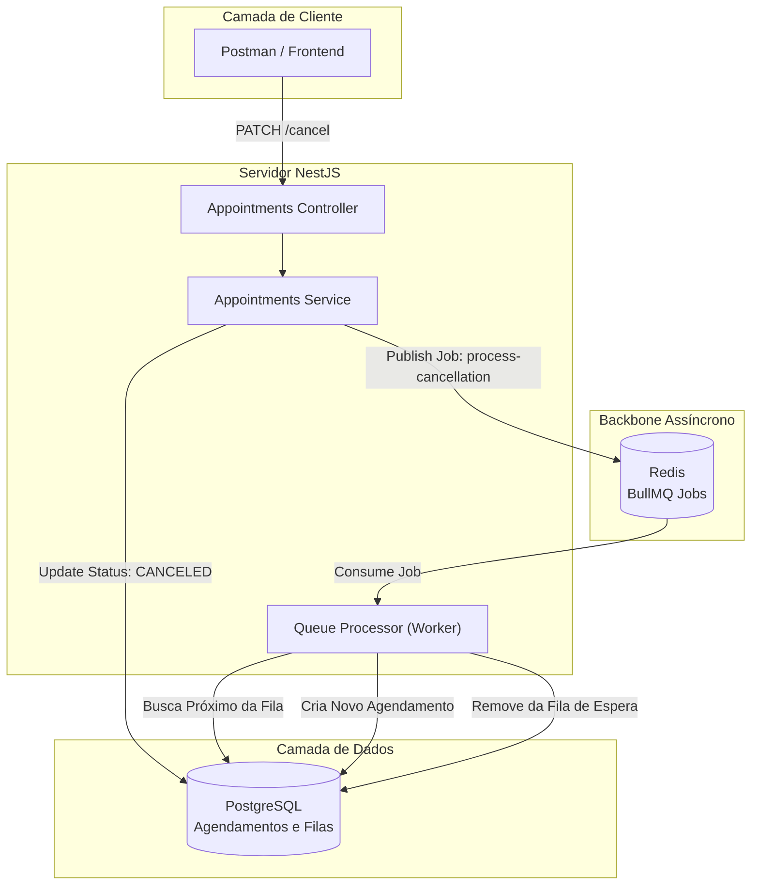

# Orquestra Queue System

English: [README.md](./README.md)

Orquestra é um ecossistema de micro-gerenciamento de agendamentos e filas de espera assíncronas. O projeto demonstra a integração entre serviços de agendamento em tempo real, persistência relacional e orquestração de eventos distribuídos para resolver o problema de ociosidade em estabelecimentos após cancelamentos.

## Visão Geral
- **Core API:** NestJS (Node.js)
- **Persistência:** PostgreSQL + Prisma ORM
- **Mensageria e Filas:** Redis + BullMQ
- **Infraestrutura:** Docker & Docker Compose

## 🚀 Funcionalidades
- **Agendamentos Dinâmicos**: Criação e gestão de horários com estados controlados.
- **Regras de Agendamento**: Bloqueio de horários passados e limites configuráveis de antecedência mínima e máxima.
- **Fila de Espera Automática**: Quando um agendamento é cancelado, um Job é enviado para o Redis.
- **Processamento Assíncrono**: Um Worker (Processor) processa a fila em segundo plano, promovendo o próximo cliente da lista de espera para o horário vago.
- **Arquitetura Escalável**: Separação clara entre Producers e Consumers.

## Arquitetura em Resumo


## Notas de Arquitetura
- **Resiliência com BullMQ:** O uso do Redis + BullMQ garante que, mesmo sob alta carga, o processamento da fila de espera não bloqueie a thread principal da API, mantendo a resposta ao usuário final rápida.
- **Consistência de Dados:** Operações críticas no processador (como promover um cliente da fila para um agendamento) são executadas via Prisma Transactions, garantindo que o cliente nunca seja removido da fila sem que o agendamento seja criado com sucesso.
- **Isolamento de Infra:** O projeto é totalmente "dockerizado", permitindo que o banco de dados e o motor de filas subam com um único comando, garantindo paridade entre ambientes de desenvolvimento e produção.

## API Endpoints
A API expõe os seguintes endpoints para a gestão de agendamentos e filas:

As regras de antecedência são aplicadas a novos agendamentos e remarcações. Por padrão, o agendamento deve ocorrer com pelo menos 15 minutos de antecedência e no máximo 90 dias. Configure `BOOKING_MIN_NOTICE_MINUTES` e `BOOKING_MAX_ADVANCE_DAYS` nas variáveis de ambiente para ajustar esses limites. Horários inválidos ou no passado são rejeitados pela API.
### Catálogo de horários
| Método | Endpoint | Descrição |
| :--- | :--- | :--- |
| `POST` | `/appointment-slots` | Adiciona um horário predefinido ao catálogo de um estabelecimento. |
| `GET` | `/appointment-slots/establishment/:establishmentId` | Lista os horários configurados em ordem cronológica. |
| `PATCH` | `/appointment-slots/:id` | Altera o horário inicial se não houver agendamento ativo ou fila dependente dele. |
| `PATCH` | `/appointment-slots/:id/activation` | Ativa ou desativa um horário usando `{ "isActive": boolean }`. |
| `DELETE` | `/appointment-slots/:id` | Remove o horário se não houver agendamento ativo ou clientes na fila. |

Cadastre o horário antes de aceitar agendamentos nele. A edição altera apenas o horário inicial. Novos horários ficam ativos por padrão. A desativação só é permitida quando não há agendamento ativo nem clientes na fila, preservando agendamentos existentes e evitando deixar clientes presos na fila. A reativação pode ser feita a qualquer momento. Horários inativos continuam no catálogo, mas não aceitam novos agendamentos, e o worker não promove clientes da fila para eles. Envie este corpo para alterar o estado:
```json
{
  "isActive": false
}
```

### Agendamentos (Appointments)
| Método | Endpoint | Descrição |
| :--- | :--- | :--- |
| `POST` | `/appointments` | Cria um agendamento ou adiciona o cliente à fila daquele horário se estiver ocupado. O horário solicitado precisa existir no catálogo. |
| `PATCH` | `/appointments/:id/cancel` | Cancela um agendamento e dispara o processamento da fila daquele horário. |

## Início Rápido
```bash
# Clonar o repositório
git clone https://github.com/galesTV/orquestra-queue-system.git

# Subir a infraestrutura (Postgres e Redis)
docker compose up -d

# Instalar dependências
npm install

# Rodar migrações do banco
npx prisma migrate dev

# Iniciar em modo de desenvolvimento
npm run start:dev
```
